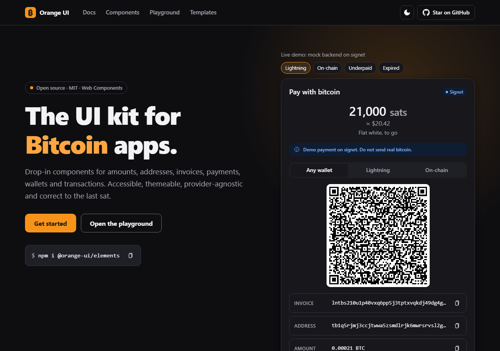

# Orange UI

**Open-source UI components for Bitcoin and Lightning web apps.** Amounts, addresses, invoices,
payments, wallets and transactions as accessible, themeable web components that work in any
framework.

[](https://github.com/yantra-commons/BITKIT/actions/workflows/ci.yml)
[](https://www.npmjs.com/package/@orange-ui/elements)
[](./.size-limit.json)
[](./LICENSE)
[](https://bitkit.dvsv2004.workers.dev/docs/guides/accessibility/)

[Documentation](https://bitkit.dvsv2004.workers.dev/) · [Components](https://bitkit.dvsv2004.workers.dev/docs/components/checkout/) · [Playground](https://bitkit.dvsv2004.workers.dev/playground/) · [Templates](https://bitkit.dvsv2004.workers.dev/templates/) · [llms-full.txt (for AI tools)](https://bitkit.dvsv2004.workers.dev/llms-full.txt)



## 30-second quickstart

No build step:

```html
<script
  type="module"
  src="https://cdn.jsdelivr.net/npm/@orange-ui/elements/dist/cdn/orange-ui.js"
></script>

<ou-pay-button amount="21000" adapter="mock" description="Flat white"></ou-pay-button>
```

Click the button and a complete checkout opens: unified QR, Lightning and on-chain tabs,
countdown and live status, simulated on signet by the mock adapter.

With a bundler:

```sh
npm install @orange-ui/elements @orange-ui/adapters
# or the typed wrappers
npm install @orange-ui/react   # React 18/19
npm install @orange-ui/vue     # Vue 3
```

```tsx
import { Checkout } from '@orange-ui/react';
import { createHttpAdapter } from '@orange-ui/adapters/http';

const adapter = createHttpAdapter({ baseUrl: '/api/payments' }); // your server holds the API key

<Checkout adapter={adapter} amount={21000n} onPaid={(e) => console.log(e.detail.invoice.id)} />;
```

## What's inside

| Package                                                                    |                                                                                                                                                         |
| -------------------------------------------------------------------------- | ------------------------------------------------------------------------------------------------------------------------------------------------------- |
| [`@orange-ui/elements`](./packages/elements)                               | 37 Lit web components: checkout, pay button, amount and address inputs, QR, fee selector, transaction list, wallet connect, recovery-phrase flows…      |
| [`@orange-ui/core`](./packages/core)                                       | Headless TypeScript: bigint money math, address validation (BIP-173/350), BIP21 + unified QR, BOLT11/12, LNURL, Lightning Address, fees, BIP39 helpers. |
| [`@orange-ui/adapters`](./packages/adapters)                               | `PaymentAdapter` interface with mock, BTCPay Server, LNbits, OpenNode, Nostr Wallet Connect and HTTP adapters; mempool.space prices and fees.           |
| [`@orange-ui/tokens`](./packages/tokens)                                   | Design tokens: JSON → CSS custom properties, light and dark, AA-contrast tested.                                                                        |
| [`@orange-ui/react`](./packages/react), [`@orange-ui/vue`](./packages/vue) | Typed wrappers generated from the custom elements manifest.                                                                                             |

## Principles

- **Framework-agnostic.** Standard Web Components, SSR-safe, with per-component imports.
- **Correct to the sat.** No floating-point money math anywhere. Tested against BIP and BOLT spec vectors.
- **Accessible.** WCAG 2.2 AA, keyboard-complete, axe-audited in Chromium, Firefox and WebKit.
- **Non-custodial.** No keys, ever. Recovery phrases stay in memory: never in attributes, events, storage or the network.
- **Provider-agnostic.** A small adapter interface, and secret API keys never go in the browser.
- **Built on the [Bitcoin Design Guide](https://bitcoin.design)** and [Bitcoin Icons](https://bitcoinicons.com).

## Development

```sh
pnpm install
pnpm build          # all packages, examples and the website
pnpm test           # unit + component + axe tests
pnpm e2e            # Playwright (run `pnpm exec playwright install` once)
pnpm storybook      # component workbench
pnpm --filter @orange-ui/website dev
```

See [CONTRIBUTING.md](./CONTRIBUTING.md), [docs/PLAN.md](./docs/PLAN.md) and
[docs/ROADMAP.md](./docs/ROADMAP.md). Security issues: [SECURITY.md](./SECURITY.md).

## License

[MIT](./LICENSE)
